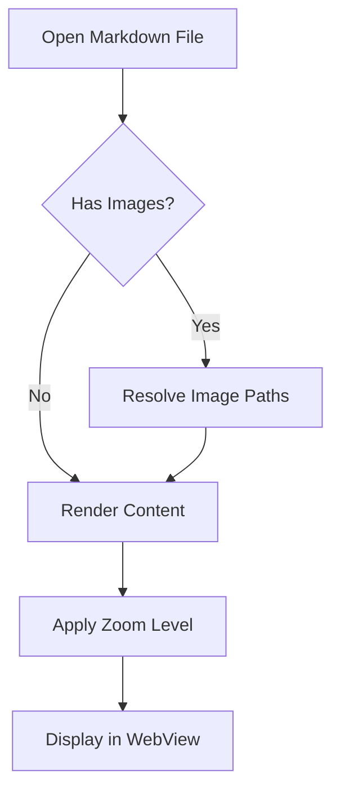
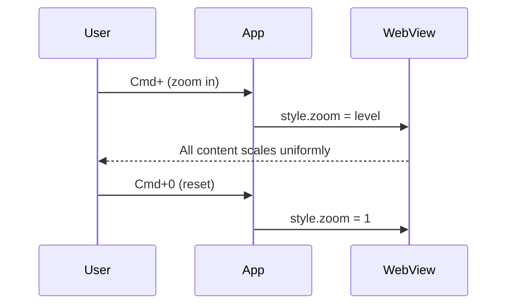

# Zoom Test Document

This file tests that **Cmd+/Cmd-** zoom scales everything uniformly — text, images, mermaid diagrams, code blocks, and tables.

## Mermaid Flowchart



## Mermaid Sequence Diagram



## Image

Here's an image that should scale with zoom:


## Code Block

```python
def apply_zoom(level):
    """Zoom scales text, images, SVGs, and all content uniformly."""
    element.style.zoom = level / DEFAULT_FONT_SIZE
    # Unlike font-size, CSS zoom affects everything:
    # - Text paragraphs
    # - Images (png, jpg, gif)
    # - SVG diagrams (mermaid)
    # - Code blocks (this one!)
    # - Tables, borders, padding
```

## Table

| Feature | font-size | CSS zoom | transform:scale |
|---------|-----------|----------|-----------------|
| Scales text | ✅ | ✅ | ✅ |
| Scales images | ❌ | ✅ | ✅ |
| Scales SVGs | ❌ | ✅ | ✅ |
| Reflows layout | ✅ | ✅ | ❌ |
| Best for apps | ❌ | ✅ | ❌ |

## Nested List

1. Try zooming in with **Cmd+** (or Ctrl+)
   - Text should get bigger
   - The mermaid diagrams above should scale
   - The image should grow
   - This nested list should scale too
2. Try zooming out with **Cmd-**
3. Reset with **Cmd+0**

> **Tip:** If only the text scales but images and diagrams stay the same size, the zoom is using `font-size` instead of CSS `zoom`.

